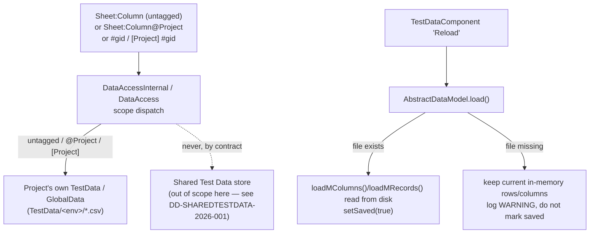

# Design & Requirement Document — Project Test Data: Backward-Compatible Scope Resolution & Reload Safety

> Companion to [DD-SHAREDTESTDATA-2026-001](DD-SHAREDTESTDATA-2026-001-shared-test-data-mvp.md)
> (Shared Test Data MVP). That doc owns the app-root Shared Test Data store, the `@Shared` tag,
> and the "Make As Shared TestData" promotion flow. This doc owns the other side of the same
> change: the guarantee that a project's **own** Test Data / Global Data — untagged or explicitly
> `@Project`/`[Project]` — keeps resolving exactly as it did before, and a reload-safety fix in
> the shared `AbstractDataModel` base class that both docs' flows depend on.

## 1. Context

Introducing the `@Shared`/`[Shared]` scope tag (see DD-SHAREDTESTDATA-2026-001) meant every Test
Data / Global Data reference in an existing project — which carries no tag at all — now had to be
routed through a new scope-aware dispatch point (`DataAccessInternal.getModel`/`getDefModel`,
`DataAccess.getGlobalData`) without changing its resolved value or its environment-fallback
behavior. This doc tracks that backward-compatibility surface area, and a related bug surfaced
while building/testing the "Make As Shared TestData" promotion flow: `AbstractDataModel.load()`
(the base class behind `TestDataModel`, used by both Project and Shared Test Data) was unconditionally
clearing in-memory rows/columns and marking the model "saved" even when its backing CSV file
didn't exist (e.g. mid-promotion, immediately after a sheet's file was moved) — silently
discarding unsaved edits on a Reload.

## 2. Scope

**In scope**
- Guarantee: an untagged or `@Project`-tagged Test Data `Sheet:Column` reference resolves only
  against the project's own Test Data (`TestData.getTestDataFor(runEnv())` / `defData()`), with
  the pre-existing "environment exists, else Default" fallback unchanged — never consults Shared
  Test Data.
- Guarantee: an untagged or `[Project]`-tagged Global Data (`#gid`) reference resolves only
  against the project's own Global Data — never Shared Global Data.
- `AbstractDataModel` reload-safety fix: `load()` only clears/replaces in-memory rows or columns
  — and only marks the model "saved" — for the parts it actually read back from disk; a missing
  backing file leaves current in-memory state untouched instead of wiping it.

**Out of scope / non-goals**
- The Shared Test Data store, `@Shared`/`[Shared]` resolution, "Make As Shared TestData", and
  `projects.items` consumer tracking — see DD-SHAREDTESTDATA-2026-001.
- The CSV `Scope` column (Test Plan / `[Project]` Reusable / `[Shared]` Reusable row tagging) and
  its legacy migration in `CsvDataProvider` — that column and its migration logic predate this
  branch (introduced by PR #356, already on `release/4.0.0`) and were not modified here.

## 3. Requirements

| REQ ID | Requirement | Acceptance Criteria |
|---|---|---|
| REQ-001 | Untagged / `@Project` Test Data `Sheet:Column` references resolve only against the project's own Test Data. | `DataAccessInternal.getModel`/`getDefModel`, `isSharedScopeSheet` false branch; `CommandControlGetDataSheetValueTest`. |
| REQ-002 | Untagged / `[Project]` Global Data (`#gid`) references resolve only against the project's own Global Data, never touching `Project.getSharedTestData()`. | `DataAccessTest.testGetGlobalDataUntaggedNotFoundThrowsWithProjectIndicator` asserts `verifyNoInteractions(project)`. |
| REQ-003 | `isInputPatternDataSheet` recognizes bare and braced `Sheet:Column@Project` (and `@Shared`) as a Test Data reference, so IDE validation/coloring is unaffected by the new tag. | `DataProcessorStaticTest` bare/braced `@Project`/`@Shared` cases. |
| REQ-004 | A Test Data model `Reload` never discards in-memory rows/columns when its backing CSV file is missing; it only marks itself "saved" for the parts actually read from disk. | `AbstractDataModel.load()` / `loadMRecords()` / `loadMColumns()` return whether they read anything; `setSaved(true)` only follows a successful read. |

## 4. Rationale / Design Decisions

**Reload-safety fix logs a warning and keeps current rows, rather than failing the Reload or
prompting the user.** This follows the existing pattern already used elsewhere in the codebase
for a missing/unreadable backing file (warn and preserve in-memory state) rather than introducing
a new failure or confirmation mode specific to this fix. Hardening this further (e.g. a
rename/surface the warning in the UI) is left as an improvement for a later release.

**Isolation is enforced by never calling `project().getSharedTestData()` on the untagged path**,
rather than a single branch with a guard. This also follows the existing pattern used for
scope-gated lookups elsewhere in the codebase — the untagged/`@Project`/`[Project]` code path
simply doesn't reference the Shared accessor at all, rather than reaching it and branching away.
Consolidating the branches is left as a later-release improvement, not required for this MVP.

## 5. Architecture & Data Flow

## 6. Code Flow

**Scope isolation (untagged / `@Project` / `[Project]`):**
1. `DataAccessInternal.getModel`/`getDefModel` check `isSharedScopeSheet(sheet)`; when false,
   `stripProjectSheetScopeTag` removes an explicit `@Project` suffix (a no-op for a bare name) and
   looks the sheet up only via the project's own `TestData` provider.
2. `DataAccess.getGlobalData` checks for a leading `[Shared]` tag; without it (untagged or
   `[Project]`), it resolves only against the project's own `GlobalDataModel` and never calls
   `context.project().getSharedTestData()`.
3. `validEnvFor` picks `validEnv` (project `runEnv()`) for this path, preserving the pre-existing
   "environment exists, else Default" fallback exactly as it worked before scope tags existed.

**Reload safety:**
1. `AbstractDataModel.load()` calls `loadMColumns()` and `loadMRecords()`, each now returning
   whether they actually read something from disk.
2. If the backing file exists, columns/records are cleared and reloaded as before, and
   `setSaved(true)` follows.
3. If the backing file is missing, the current in-memory rows/columns are left untouched, a
   WARNING is logged, and the model is **not** marked saved — so a subsequent real Save still
   persists the in-memory state instead of it having been silently discarded.

## 7. Protected / Do-Not-Modify Inventory

| Item | Reason |
|---|---|
| Bare `Sheet:Column` / untagged `#gid` resolution semantics | Must remain byte-for-byte identical to pre-scope-tag behavior — no migration, no behavior change for projects that never use `@Shared`/`[Shared]`. |
| `validEnv(TestCaseRunner)` (project-only environment-fallback check) | Reused unchanged for the untagged/`@Project` path; only the Shared path gets the new `validSharedEnv` counterpart. |
| `AbstractDataModel` save/undo-redo semantics for the file-exists path | Unchanged — the fix only changes behavior when the backing file is missing. |

## 8. Error Handling & Edge Cases

- `Reload` on a model whose backing file doesn't exist (e.g. a sheet mid-move, or a model backed
  by a file deleted outside the IDE) logs `WARNING` with the file path and keeps current rows —
  it does not throw and does not silently empty the grid.
- `DataAccessTest`'s not-found-path tests confirm the untagged/`[Project]` GID lookup never
  interacts with the `Project` mock at all (`verifyNoInteractions(project)`), guarding against a
  future regression that routes project-scope errors through Shared lookups by accident.

## 9. Test Scenarios & Test Cases

<!-- Scenario/Test Case codes are placeholders — reconcile against the live RTM Masterlist
     (see the RTM-test-generator agent) before finalizing. -->

| Scenario Code | Scenario | Test Case Code | Steps | Expected Result | Execution Mode |
|---|---|---|---|---|---|
| DS-SC001 | Untagged Test Data reference resolves to project data only | DS-SC001-TC001 | Covered by `CommandControlGetDataSheetValueTest` | Untagged `Sheet:Column` resolves via the project's own Test Data, Default-env fallback preserved | Unit |
| DS-SC002 | Untagged / `[Project]` Global Data never consults Shared | DS-SC002-TC001 | Covered by `DataAccessTest.testGetGlobalDataUntaggedNotFoundThrowsWithProjectIndicator` | Not-found error indicates "Project GlobalData"; no interaction with `Project.getSharedTestData()` | Unit |
| DS-SC003 | `isInputPatternDataSheet` recognizes `@Project`/bare forms | DS-SC003-TC001 | Covered by `DataProcessorStaticTest` (bare/braced `@Project`/`@Shared` cases) | IDE validation/highlighting unaffected by the new trailing tag | Unit |
| DS-SC004 | `TestStep`/`TestCase` scope-tag helpers on untagged input | DS-SC004-TC001 | Covered by `TestStepTest`, `TestCaseTest` | `isTestDataStep`/`getTestDataFromInput` behave as before for untagged input | Unit |
| DS-SC005 | Reload does not discard unsaved rows when backing file is missing | DS-SC005-TC001 | **Gap** — no dedicated unit test found for `AbstractDataModel.load()`'s missing-file path in this branch | Reload logs a warning and preserves in-memory rows/columns | Unit (to be added) |

## 10. Rollout / Migration / Rollback

- No data migration: untagged references and existing CSVs are unaffected — this doc's changes
  are purely resolution-path and in-memory-model behavior.
- The reload-safety fix is a pure bug fix with no rollout steps; rollback is a plain revert of
  `AbstractDataModel.java` if needed.

## 11. Open Questions & Risks

- [ ] Reload-safety warning-and-keep-rows behavior, and the never-call-Shared isolation pattern,
      are flagged for possible refinement (e.g. surfacing the warning in the UI, consolidating
      the scope branches) in a later release — not required for this MVP.

## 12. Revision History

| Version | Date | Author | Change |
|---|---|---|---|
| 1.0 | 2026-10-15 | GitHub Copilot (design-doc-writer) | Initial draft documenting project-scope backward-compatibility guarantees and the AbstractDataModel reload-safety fix, as a companion to DD-SHAREDTESTDATA-2026-001 |
