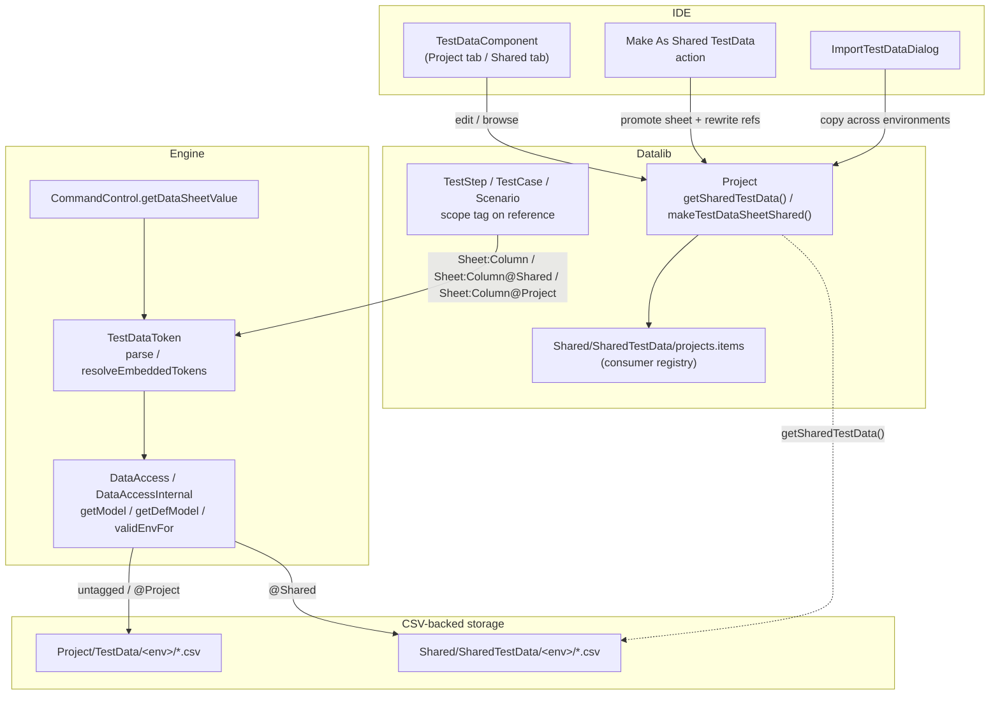

# Design & Requirement Document — Shared Test Data MVP

> See also [DD-PROJECTTESTDTA-2026-002](DD-PROJECTTESTDTA-2026-002-project-test-data-scope-and-reload-safety.md)
> for the companion backward-compatibility guarantees (untagged/`@Project`/`[Project]` resolution
> stays project-only) and the `AbstractDataModel` reload-safety fix that both flows depend on.

## 1. Context

**User Story:** *Introduce Shared Test Data for Cross-Project Reusability* — as an INGenious
engineer, I want to create and consume Shared Test Data across projects, so that test data can be
centrally managed, reused, and maintained consistently across multiple automation projects.

INGenious already supports reusable assets through Shared Object Repositories and Shared Reusable
Components, enabling engineers to centralize and share common automation artifacts across
projects. Before this change, there was no equivalent for test data: Test Data (`Sheet:Column`)
and Global Data (`#gid`) references always resolved against the current project's own CSV-backed
store (`TestData/<env>/*.csv`). Reusing common reference data (environment URLs, shared accounts,
lookup tables, etc.) across multiple projects meant copy-pasting datasheets into each one and
keeping them in sync by hand.

**Goal:** provide a Shared Test Data capability that enables engineers to create, maintain, and
consume test data assets across multiple INGenious projects, using the same sharing model as
Shared Object Repositories and Shared Reusable Components — managed as a centralized asset and
referenced by consuming projects rather than duplicated across repositories.

**Value:**
- Eliminates duplication of test data across projects.
- Promotes reuse of common datasets.
- Simplifies maintenance of shared test data.
- Ensures consistency across automation projects.
- Reduces effort when updating commonly used test data.
- Aligns test data management with existing shared asset capabilities.

This branch introduces **Shared Test Data**: an app-root-level test data store
(`Shared/SharedTestData/`) that any project can opt into on a per-reference basis via an explicit
scope tag, resolved through the same `DataAccess`/`DataAccessInternal` pipeline used for project
data. An earlier iteration of this same branch (commit `a1c3fbb2`) used a leading
`[Shared]`/`[Project]` bracket tag on the *scenario name* for Test Data sheets; this was replaced
(commit `041bf5a8`'s description, finalized in follow-up commits) with a trailing `@Shared`/
`@Project` tag directly on the `Sheet:Column` reference, to mirror the existing `[Shared]`/
`[Project]` convention already used for Global Data GIDs and Reusable Components without
colliding with it syntactically. A later commit (`4e62b211`) removed an initial design where
Shared Test Data had its own independent "Environment" selector (`RunSettings.setSharedTestEnv`),
simplifying it so Shared Test Data always follows the project's own selected Environment.

**Repository:** https://github.com/ing-bank/INGenious
**Framework documentation:** https://ing-bank.github.io/ingenious-doc/knowyourframework/

## 2. Scope

**Directly impacted components (per the User Story)**
- Shared Asset Management — Shared Test Data definition, registration, discovery, consumption.
- Project Configuration — Shared Test Data references, shared-asset dependency management.
- Test Data Framework — test data loading, resolution, shared data access mechanisms.
- Generators and Utilities — Shared Test Data support, validation logic.
- User Interface and Configuration Screens — Shared Test Data management, Shared Test Data selection.
- Documentation — setup, usage, migration/adoption guidance (see Open Questions — not produced by
  this branch; tracked separately).

**In scope**
- `@Shared` / `@Project` trailing scope tag on Test Data `Sheet:Column` references (bare/untagged
  == `@Project`, unchanged canonical behavior, no migration needed for existing projects).
- `[Shared]` / `[Project]` leading scope tag on Global Data (`#gid`) references, with inheritance
  of the containing sheet's scope for untagged GID values.
- Resolution pipeline changes in `DataAccessInternal` / `CommandControl` / `TestDataToken` to
  route tagged and untagged references through one scope-aware path (project data vs. app-root
  Shared Test Data), each with its own "environment exists, else fall back to Default" check.
- IDE: a dedicated "Shared Test Data" tab (`TestDataComponent(shared=true)`), a "Make As Shared
  TestData" action that promotes a project datasheet into Shared Test Data and rewrites every
  referencing step (whole-input and embedded `{Sheet:Column}` tokens inside larger payloads
  alike) — unconditionally, even when the same sheet name still exists in another project
  environment — a confirmation flow before renaming/deleting shared data that other projects
  depend on (`Shared/SharedTestData/projects.items` manifest), and an `ImportTestDataDialog` for
  copying data across environments.
- Promoting to Shared Reusables during "Make As Shared TestData" only ever offers Project
  Reusable test cases; Test Plan test cases are retagged to `@Shared`/`[Shared]` without a
  promotion prompt, since they aren't invocable reusable components.
- Moving a whole Test Data environment to Shared keeps the project environment (folder and IDE
  tab), emptied of its own Global Data, rather than deleting it — the same treatment `Default`
  always received.
- Quick Settings and the project Settings screen list the union of the project's own
  environments and Shared Test Data's environments (de-duplicated) wherever an environment
  picker reads `getEnvList()`.
- After "Make As Shared TestData" completes, a currently-open test case editor is re-resolved
  against the reloaded project and rebound, instead of continuing to show its pre-reload
  `TestCase` instance (stale Input/reference values, or a now-deleted file path).
- One-time, best-effort CSV migration that populates a missing `Scope` column for legacy
  datasheet CSVs on first load.
- Unit/integration test coverage: `TestDataTokenTest`, `DataAccessInternalTest`,
  `SharedTestDataResolutionIntegrationTest`, `CommandControlGetDataSheetValueTest`,
  `MakeSharedTestDataTest`, `ProjectRefactorSharedTestDataTest`, `EnvTestDataImportTest`, and
  others listed in §9.

**Out of scope / non-goals**
- A Shared Test Data environment independent from the project's own Environment selection (this
  was attempted and then explicitly removed in commit `4e62b211`).
- Changes to existing Shared Object Repository behavior.
- Changes to existing Shared Reusable Component behavior — their existing `projects.items`
  convention is reused as-is for Shared Test Data, not modified.
- Automatic synchronization of project-specific (non-shared) test data.
- Introduction of new test data formats — any new data-provider backend (database-backed Test
  Data, etc.) is out of scope; still CSV-backed via `CsvDataProvider`.

## 3. Requirements

| REQ ID | Requirement | Acceptance Criteria |
|---|---|---|
| REQ-001 | A Test Data `Sheet:Column` reference may carry an optional trailing `@Shared`/`@Project` tag, inside or outside braces. | `TestDataToken.isReference`/`parse` accept all forms; untagged behaves identically to `@Project`. |
| REQ-002 | `@Shared`-tagged references resolve against the app-root Shared Test Data store; untagged/`@Project` resolve against the project's own Test Data. | `DataAccessInternal.getModel`/`getDefModel` dispatch on `isSharedScopeSheet`; `getSharedModel` reads `context.project().getSharedTestData()`. |
| REQ-003 | Shared Test Data environment selection always follows the project's own selected Environment (no separate Shared environment setting). | `RunSettings.setSharedTestEnv`/`getSharedTestEnv` removed; `validSharedEnv` checks the project's `sharedRunEnv()` against the Shared store's environments. |
| REQ-004 | The IDE can promote a project datasheet to Shared Test Data ("Make As Shared TestData"), rewriting all referencing Test Plan / Project Reusable / Shared Reusable steps to the shared tag. | `TestDataComponent.makeSelectedSheetShared` → `Project.makeTestDataSheetShared(envName, sheetName, toPromote)`. |
| REQ-005 | Legacy CSV files without a `Scope` column are migrated once, best-effort, inferring scope from scenario naming or unique scenario/test-case match; ambiguous rows are left unset and logged, never guessed. | `CsvDataProvider.migrateLegacyRecords` / `resolveScopeByUniqueMatch`. |
| REQ-006 | Renaming/deleting a Shared Test Data sheet or environment warns when other projects reference it. | `TestDataComponent.confirmSharedTestDataChange` + `Project.getOtherProjectsUsingSharedTestData()` / `Shared/SharedTestData/projects.items`. |
| REQ-007 | A Global Data (`#gid`) reference inside a `@Shared`-scoped Test Data cell inherits the `[Shared]` scope when it carries no explicit tag of its own; an explicitly tagged value is left untouched. | `DataAccessInternal.inheritSheetScopeForGlobalDataRef`. |
| REQ-008 | Users can import Test Data across environments via a dedicated dialog. | `ImportTestDataDialog` (IDE), covered by `EnvTestDataImportTest`. |
| REQ-009 | A reference to a sheet that doesn't exist anywhere (neither project nor Shared) produces a clearer error than one that exists but lacks the requested iteration/column. | `DataAccessInternal.sheetExists` enriches `TestDataNotFoundException` message. |
| REQ-010 | Shared Test Data assets are discoverable in the IDE (browse/select) rather than only addressable by name. | `TestDataComponent(shared=true)` Shared Test Data tab. |
| REQ-011 | Existing projects that do not use Shared Test Data see no behavior change and require no migration. | See companion doc DD-PROJECTTESTDTA-2026-002 (backward-compatibility guarantees); covered by SDS-SC015. |
| REQ-012 | Shared Test Data setup/usage/consumption is documented consistently with Shared Object Repository / Shared Reusable Components. | Not produced by this branch — see Open Questions & Risks. |
| REQ-013 | Promoting a sheet (or a whole environment) to Shared Test Data always retags every referencing step to the shared tag, even when the same sheet name still exists in another, unmoved project environment; that other environment's own copy is left in place but unreferenced. | `Project.moveSheetToSharedInEnv` / `makeTestDataSheetShared` no longer branch on `findEnvironmentsWithDatasheet`; `MakeSharedTestDataTest.movingANonDefaultEnvironmentLeavesDefaultsOwnSheetButRetagsReferencesAnyway`. |
| REQ-014 | The "also convert to Shared Reusables?" prompt shown during promotion only lists Project Reusable test cases; Test Plan test cases are retagged automatically, without being offered in the prompt. | `Project.getPromotableTestCasesForSheet` / `TestDataComponent.askMoveTestCasesToShared` filter on `scenario.isReusableScenario()`; `MakeSharedTestDataTest.promotesProjectReusableTestCaseAndRetagsItsDataReference`. |
| REQ-015 | Promotion retags embedded `{Sheet:Column}` tokens (bare or `@Project`-tagged) found inside a larger payload Input — webservice/MQ body, SQL text, file template — the same way as whole-input references, leaving other sheets' tokens and already-`@Shared` tokens untouched. | `TestCase.retagEmbeddedTokens`; `MakeSharedTestDataTest.retagsEmbeddedTokensInsideJsonPayloadsTooNotJustWholeInputs` / `retagsEmbeddedTokenNestedDeepInsideJsonObjectsAndRetagsProjectTaggedOnesToo`. |
| REQ-016 | Moving a whole Test Data environment to Shared keeps that project environment (folder/tab) instead of deleting it; only its Global Data is cleared. | `Project.moveTestDataEnvironmentToShared` no longer calls `testData.deleteEnvironment(env)` for non-`Default` environments; `MakeSharedTestDataTest.movesEveryDatasheetOfAnEnvironmentButKeepsItEmptied`. |
| REQ-017 | The Quick Settings and project Settings environment picker lists the union of the project's own environments and Shared Test Data's environments. | `QuickSettings.getEnvList()` / `INGeniousSettings.getEnvList()` union `project().getTestData().getEnvironments()` with `project().getSharedTestData().getEnvironments()`. |
| REQ-018 | After a "Make As Shared TestData" promotion, a currently-open test case editor reflects the reloaded project's fresh `TestCase` instance rather than stale pre-reload data. | `TestDataComponent.refreshAfterMakeShared` / `findTestCaseAcrossScopes`. |

## 4. Rationale / Design Decisions

**Trailing `@Shared`/`@Project` tag, not a prefix or a separate metadata column.** The
`Sheet:Column` reference is read and written in many places across the test design (step Input,
write-destinations, auto-suggests, embedded tokens in payloads/templates) by a variety of
actions. Keeping the tag trailing preserves that familiar `Sheet:Column` shape wherever it
appears, so it stays easy to read at a glance; a leading prefix or an out-of-band metadata column
would either disrupt that shape or risk the scope information not traveling with the reference
itself.

**Shared Test Data follows the project's own Environment, not an independent Shared environment.**
An initial design gave Shared Test Data its own environment selector (`RunSettings.setSharedTestEnv`),
but this was reverted (commit `4e62b211`) so testers have one consistent environment while
executing, and the engine applies a single environment-resolution rule regardless of whether a
reference is Project- or Shared-scoped — matching established common practice for environment
handling elsewhere in INGenious, rather than introducing a second, independently-selected
environment concept for Shared data alone.

**Legacy CSV `Scope`-column migration stays best-effort and automatic on load**, rather than a
manual one-time wizard, by design — other backend work landing alongside this feature depends on
that migration having already run by load time, so deferring it to a separate manual step would
have left those code paths without the column they expect.

**Promotion always retags references now, even for a partially-moved sheet.** An earlier
iteration left references untouched (and warned the user) when the same sheet name still existed
in another, unmoved project environment, on the theory that retagging would break those other
environments. This was replaced with always retagging: moving a sheet to Shared is meant to
redirect *every* usage there, so the other environment's own copy is simply left behind,
unreferenced, rather than silently keeping some references on the old project-scoped path while
others move — a partial, environment-dependent retag was judged more confusing than a clean,
unconditional one.

**Only Project Reusable test cases are offered for promotion to Shared Reusables, not Test Plan
cases.** Test Plan test cases aren't reusable components another project or user could invoke, so
offering them in the "also promote?" dialog had no useful outcome beyond extra clicks — they are
retagged to the shared tag like any other referencing step, without being added to that prompt.

**Moving a whole environment to Shared now keeps the project environment instead of deleting
it.** The original behavior removed the environment entirely (folder, `GlobalData.csv`, tab) for
any environment other than `Default` (which could not be removed and was instead left empty).
That asymmetry — `Default` surviving emptied, every other environment disappearing — was replaced
by giving every environment the same treatment `Default` always had: the folder/tab stays
available for new Test Data, only its Global Data is cleared.

## 5. Architecture & Data Flow

## 6. Code Flow

**Runtime reference resolution (step execution):**
1. A step's Input / write-destination / condition / embedded template contains a `Sheet:Column`
   reference, optionally tagged `@Shared`/`@Project` (whole-value or embedded `{...}` form).
2. `CommandControl.getDataSheetValue` and `DataProcessor`/`Webservice` fragment resolution route
   the literal or embedded token through `TestDataToken.parse` / `resolveEmbeddedTokens`, which
   strips and remembers the trailing scope tag.
3. `DataAccessInternal.getModel`/`getDefModel` branch on `isSharedScopeSheet(sheet)`:
   - untagged / `@Project` → `stripProjectSheetScopeTag` then the project's own
     `TestData.getTestDataFor(runEnv())` / `defData()`.
   - `@Shared` → `getSharedModel`, which reads `context.project().getSharedTestData()` and
     resolves against that store's matching environment, falling back to its own `Default`.
4. `validEnvFor` picks `validSharedEnv` or `validEnv` so each scope independently decides whether
   the selected Environment is "real" for it or should fall back to Default.
5. A bare `#gid` Global Data value read out of a `@Shared`-scoped sheet inherits the `[Shared]`
   tag via `inheritSheetScopeForGlobalDataRef`, unless already explicitly tagged.
6. `sheetExists` distinguishes "sheet not found anywhere" from "sheet found but the requested
   iteration/column is missing" to produce a precise `TestDataNotFoundException` message.

**IDE "Make As Shared TestData" promotion:**
1. User right-clicks a project datasheet in the Test Data panel →
   `TestDataComponent.makeSelectedSheetShared`.
2. A confirmation dialog asks which impacted **Project Reusable** test cases should also be
   promoted to Shared Reusables (`askMoveTestCasesToShared`, filtered to
   `scenario.isReusableScenario()`); impacted Test Plan test cases are never offered here.
3. `Project.makeTestDataSheetShared(envName, sheetName, toPromote)` moves the CSV under
   `Shared/SharedTestData/<env>/` and unconditionally rewrites every Test Plan / Project
   Reusable / Shared Reusable step reference to the `@Shared` tag — both whole-input references
   (`TestCase.retagTestDataReferencesToShared`) and embedded `{Sheet:Column}` tokens inside a
   larger payload Input (`TestCase.retagEmbeddedTokens`) — even when the sheet name still exists
   in another, unmoved project environment.
4. `registerSharedTestDataUsage()` / `addSharedTestDataProjectEntry()` update
   `Shared/SharedTestData/projects.items` so other projects' Shared-panel rename/delete warnings
   stay accurate.
5. `refreshAfterMakeShared()` reloads the project, refreshes auto-suggests/trees, then
   re-resolves a currently-open test case editor by scenario/test-case name across the reloaded
   project's scopes (`findTestCaseAcrossScopes`) and rebinds it to the fresh `TestCase` instance,
   so it reflects the promoted sheet and any newly-promoted Shared Reusable test cases instead of
   showing stale data.

## 7. Protected / Do-Not-Modify Inventory

| Item | Reason |
|---|---|
| Bare (untagged) `Sheet:Column` resolution behavior | Must keep resolving exactly as before — project's own Test Data, canonical form, no migration required for existing projects (explicitly called out in `TestDataToken`'s javadoc). |
| CSV files whose `Scope` column already has values | `migrateLegacyRecords` must only run for files where the column was just spliced in this load; a file that already had the column keeps whatever it has, untouched. |
| Shared Reusable Components / Shared Object Repository `projects.items` convention | Reused as-is for Shared Test Data's own `projects.items`; not to be altered by this change. |
| Non-`@Shared`-sheet Global Data `#gid` references | Must keep defaulting to Project scope when untagged — only a `@Shared` sheet's own cells get scope inheritance. |
| The plain, un-subclassed `DataNotFoundException` "Reached the end of data sheet" signal (`EndOfDataSheet`) | Must always propagate unchanged through `CommandControl.getDataSheetValue`, `TestDataToken`'s embedded-token resolution, and `TestStepRunner`'s quiet reporting pass — a dynamic (index-less) Param Loop relies on it to know when to stop; only `TestDataNotFoundException`/`GlobalDataNotFoundException` are allow-listed as "safe to swallow/leave as literal". |
| Embedded tokens for other sheets, and tokens already tagged `@Shared` | `TestCase.retagEmbeddedTokens` must leave them untouched — it only rewrites tokens matching the exact `originalName` being promoted. |

## 8. Error Handling & Edge Cases

- A scope-tagged reference to a sheet that exists nowhere (neither project nor Shared) gets an
  enriched `TestDataNotFoundException` message naming which store was checked.
- An embedded `{Sheet:Column}` token that fails to resolve (unknown sheet/column, or a
  `RuntimeException` during lookup) is logged at WARN and left as literal text, rather than
  throwing — preserves existing "unknown token stays literal" behavior for webservice/MQ payload
  templating.
- `EMBEDDED_TOKEN` excludes quoted content so a JSON object literal like `{"a":"b"}` is never
  mistaken for a data reference.
- Legacy CSV migration: when the same scenario+test-case combination exists in more than one
  scope (ambiguous), the row's `Scope` is left unset and a WARNING is logged rather than guessed;
  the structural column migration is still persisted so the file isn't reprocessed as "legacy"
  indefinitely.
- Renaming/deleting Shared Test Data used by other projects requires explicit confirmation via
  `confirmSharedTestDataChange`, listing the affected projects.
- `CommandControl.getDatasheet`/`getDataSheetValue` report failures via typed exceptions
  (`TestDataNotFoundException`, `GlobalDataNotFoundException`) rather than a null-return sentinel,
  so the logged message carries the exception's own `Env/Scope/Sheet/Field/TestCase` detail
  instead of a generic string; any other exception (chiefly `EndOfDataSheet`) is left to propagate
  unchanged.
- `TestDataToken`'s embedded-token resolution and `TestStepRunner`'s quiet reporting pass both
  allow-list exactly `TestDataNotFoundException`/`GlobalDataNotFoundException` as "leave as
  literal text" / "swallow silently" — any other exception type keeps propagating so a dynamic
  Param Loop's `EndOfDataSheet` signal still reaches it.
- `DataIterator.setIter` tolerates a `null` iteration set (a sheet that genuinely doesn't exist,
  or has no row for the current scenario/test case) by recording "0 iterations known" instead of
  throwing an NPE, letting the caller's subsequent `DataAccess.getData()` raise its own detailed
  `TestDataNotFoundException`.
- `TestDataNotFoundException`'s detail template relabels the reusable-scope field from
  `Reusable : {7}/{8}` to `User Intent : {7}/{8}` to better describe what that field conveys.

## 9. Test Scenarios & Test Cases

<!-- Scenario/Test Case codes are placeholders — reconcile against the live RTM Masterlist
     (see the RTM-test-generator agent) before finalizing. -->

| Scenario Code | Scenario | Test Case Code | Steps | Expected Result | Execution Mode |
|---|---|---|---|---|---|
| SDS-SC001 | Scoped Test Data reference parsing | SDS-SC001-TC001 | Covered by `TestDataTokenTest` | Bare / `@Project` / `@Shared`, braced and unbraced forms all parse correctly | Unit |
| SDS-SC002 | Scoped sheet resolution (project vs shared) | SDS-SC002-TC001 | Covered by `DataAccessInternalTest` | `@Shared` resolves against Shared store, untagged/`@Project` against project store, with Default fallback | Unit |
| SDS-SC003 | End-to-end Shared Test Data resolution during execution | SDS-SC003-TC001 | Covered by `SharedTestDataResolutionIntegrationTest` | A test case referencing `@Shared` data resolves correctly at runtime | Integration |
| SDS-SC004 | `getDataSheetValue` unified pipeline | SDS-SC004-TC001 | Covered by `CommandControlGetDataSheetValueTest` | Tagged and untagged keys both resolve via the scope-aware pipeline, including Default fallback | Unit |
| SDS-SC005 | Make As Shared TestData promotion | SDS-SC005-TC001 | Covered by `MakeSharedTestDataTest` | Promoting a project sheet moves it to Shared storage and rewrites all referencing steps | Unit/Integration |
| SDS-SC006 | Project refactor after promotion | SDS-SC006-TC001 | Covered by `ProjectRefactorSharedTestDataTest` | References across Test Plan/Project Reusables/Shared Reusables stay consistent after promotion | Unit |
| SDS-SC007 | Cross-environment Test Data import | SDS-SC007-TC001 | Covered by `EnvTestDataImportTest` | Data imported into a different environment matches source | Unit |
| SDS-SC008 | Legacy CSV Scope-column migration | SDS-SC008-TC001 | Covered by `CsvTestDataTest` | Missing Scope column is populated once; ambiguous rows are left unset and logged | Unit |
| SDS-SC009 | Create Shared Test Data | SDS-SC009-TC001 | Promote/author a Shared Test Data asset | Asset is registered under `Shared/SharedTestData/` and becomes available to authorized projects | Manual/Integration |
| SDS-SC010 | Consume Shared Test Data from a project | SDS-SC010-TC001 | Reference a `@Shared` sheet in a project's steps | Project reads the shared data at execution time with no local copy | Integration |
| SDS-SC011 | Shared Test Data is discoverable | SDS-SC011-TC001 | Open the Shared Test Data tab in the IDE | Shared sheets/environments are visible and selectable for project usage | Manual |
| SDS-SC012 | Updates to Shared Test Data are available to consuming projects | SDS-SC012-TC001 | Edit a Shared sheet, then re-run a consuming project | Consuming project reads the updated value with no project-specific copy | Integration |
| SDS-SC013 | Behavior consistent with Shared Object Repository / Shared Reusable Components | SDS-SC013-TC001 | Compare Shared Test Data create/share/consume flow to existing Shared OR / Shared Reusables flows | Same `projects.items` consumer-tracking convention and confirmation-before-impact pattern | Manual |
| SDS-SC014 | Validation prevents invalid Shared references | SDS-SC014-TC001 | Reference a `@Shared` sheet that doesn't exist | `TestDataNotFoundException` names the Shared store as where it looked; meaningful error shown | Unit/Integration |
| SDS-SC015 | Backward compatibility for non-adopting projects | SDS-SC015-TC001 | Run a project that never uses `@Shared`/`[Shared]` | Behavior and resolved values are unchanged from before this feature; no migration required | Regression |
| SDS-SC016 | Documentation covers create/share/consume | SDS-SC016-TC001 | Review `ingenious-doc` for Shared Test Data setup, usage, consumption, and examples | Docs published and consistent with Shared Object Repository / Shared Reusable Components docs — ongoing, tracked separately | Manual (docs review) |
| SDS-SC017 | Promotion always retags references, even when the sheet name still exists in another project environment | SDS-SC017-TC001 | Covered by `MakeSharedTestDataTest.movingANonDefaultEnvironmentLeavesDefaultsOwnSheetButRetagsReferencesAnyway` | The other environment's own sheet is left in place but every reference is retagged to `@Shared`/`[Shared]` anyway | Unit/Integration |
| SDS-SC018 | Promotion prompt only offers Project Reusable test cases | SDS-SC018-TC001 | Covered by `MakeSharedTestDataTest.promotesProjectReusableTestCaseAndRetagsItsDataReference` / `promotesMultipleReusableTestCasesInSameScenarioAndRetagsAllOfThem` | Test Plan test cases are retagged without being offered in the promotion dialog; only Project Reusable cases appear there | Unit/Integration |
| SDS-SC019 | Embedded payload tokens are retagged alongside whole-input references | SDS-SC019-TC001 | Covered by `MakeSharedTestDataTest.retagsEmbeddedTokensInsideJsonPayloadsTooNotJustWholeInputs` / `retagsEmbeddedTokenNestedDeepInsideJsonObjectsAndRetagsProjectTaggedOnesToo` | A `{Sheet:Column}` token embedded inside a webservice/MQ/SQL/file payload is retagged to `{finalName:Column@Shared}`; other sheets' tokens and already-`@Shared` tokens are untouched | Unit |
| SDS-SC020 | Moving a whole environment keeps it, emptied, instead of deleting it | SDS-SC020-TC001 | Covered by `MakeSharedTestDataTest.movesEveryDatasheetOfAnEnvironmentButKeepsItEmptied` / `movingWholeEnvironmentRetagsAllReferencingReusableComponents` | The environment's folder/tab remains after the move, with its Global Data cleared, and every referencing step is retagged | Unit/Integration |
| SDS-SC021 | Environment picker lists Shared Test Data environments too | SDS-SC021-TC001 | **Gap** — no dedicated unit test found for `QuickSettings.getEnvList()` / `INGeniousSettings.getEnvList()` in this branch | Quick Settings and project Settings environment dropdowns list the union of project and Shared Test Data environments | Manual (to be added) |
| SDS-SC022 | Exception-based `getDatasheet`/`getDataSheetValue` reporting, with `EndOfDataSheet` passthrough | SDS-SC022-TC001 | Covered by `CommandControlGetDataSheetValueTest.getDatasheetReportsDetailedMessageOnTestDataNotFound` / `getDatasheetReportsDetailedMessageOnGlobalDataNotFound` / `getDataSheetValuePropagatesTestDataNotFound` / `endOfDataSheetPropagatesSoTheOwningParamLoopCanDetectIt` | Not-found failures log the exception's detailed message; `EndOfDataSheet` still propagates unchanged for dynamic Param Loops | Unit |
| SDS-SC023 | Embedded-token resolution allow-lists exactly the two "not found" exception types | SDS-SC023-TC001 | Covered by `TestDataTokenTest` | `TestDataNotFoundException`/`GlobalDataNotFoundException` are left as literal text with a WARN log; any other exception (e.g. `EndOfDataSheet`) propagates | Unit |
| SDS-SC024 | `DataIterator.setIter` tolerates a null iteration set | SDS-SC024-TC001 | Covered by `DataIteratorTest.testSetIterWithNullSetDoesNotThrow` | No NPE; iteration count recorded as 0 so the caller's own lookup can raise a detailed error | Unit |
| SDS-SC025 | Reopened test case editor reflects fresh data after promotion | SDS-SC025-TC001 | **Gap** — no dedicated unit test found for `TestDataComponent.refreshAfterMakeShared`'s editor-rebind path in this branch (UI-level fix) | A test case editor open during "Make As Shared TestData" shows the reloaded project's current Input/reference values, not stale pre-reload data | Manual (to be added) |

## 10. Rollout / Migration / Rollback

- The legacy CSV `Scope`-column migration is additive and best-effort: it runs automatically the
  first time an older project's datasheet CSV is loaded post-upgrade. Ambiguous rows are flagged
  (left blank, logged), never silently guessed — the user can set the scope explicitly afterward.
- `Shared/SharedTestData/` is created on first use (first "Make As Shared TestData" promotion or
  first manual add via the Shared tab); no action needed for projects that never use it.
- Rollback risk: reverting this branch after sheets have already been promoted to Shared Test
  Data would orphan those CSVs under `Shared/SharedTestData/` and leave `@Shared`/`[Shared]`
  tagged references in project files unresolved by the pre-change engine — promoted sheets would
  need to be manually moved back and references manually un-tagged. No automated rollback /
  un-promote tool is offered to users by design — promotion is intentionally a one-way action
  through the IDE (matching how "Make As Shared Reusable" works for Shared Reusable Components);
  reverting a promotion is an engine-branch-revert / manual-file concern, not a user-facing flow.
- Moving a whole environment to Shared no longer deletes the project environment (folder/tab) —
  it stays, emptied — which lowers the destructive footprint of that action compared to the
  earlier behavior, since there is no longer a project-side folder/`GlobalData.csv` deletion to
  reverse if the move needs to be undone.
- Promotion now always retags references rather than conditionally skipping some when a sheet
  name collides with another project environment; operators upgrading from the earlier
  partial-move behavior should expect every "Make As Shared TestData" / whole-environment move to
  fully redirect referencing steps going forward, with no partial-move warning dialog anymore.

## 11. Open Questions & Risks

- [ ] SDS-SC021 (environment-picker union) and SDS-SC025 (reopened editor rebind) have no
      dedicated automated test in this branch — both are UI-level changes exercised only
      manually so far.

## 12. Revision History

| Version | Date | Author | Change |
|---|---|---|---|
| 1.0 | 2026-10-15 | GitHub Copilot (design-doc-writer) | Initial draft documenting the Shared Test Data MVP feature on `task/shared-testdata-mvp` |
| 1.1 | 2026-10-21 | GitHub Copilot (design-doc-writer) | Documented commit `edd66428`: promotion now always retags references (no more partial-move skip/warning), embedded-token retagging inside payload bodies, Project-Reusable-only promotion prompt, whole-environment moves keep the environment instead of deleting it, Quick Settings/Settings environment-list union with Shared Test Data, reopened test case editor refresh after promotion, and exception-based `getDatasheet`/`getDataSheetValue` error reporting with `EndOfDataSheet` passthrough for dynamic Param Loops |
